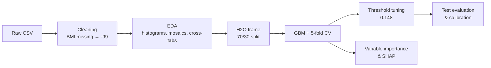
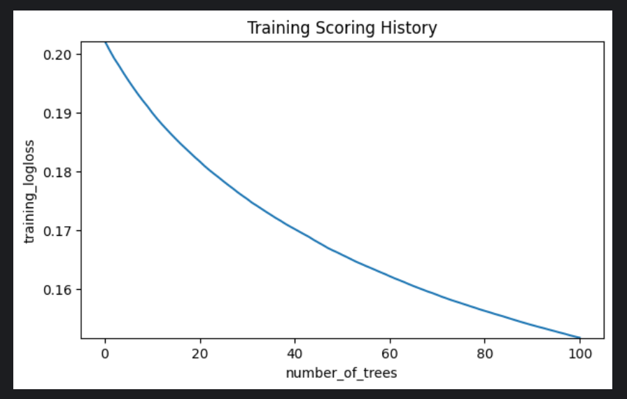
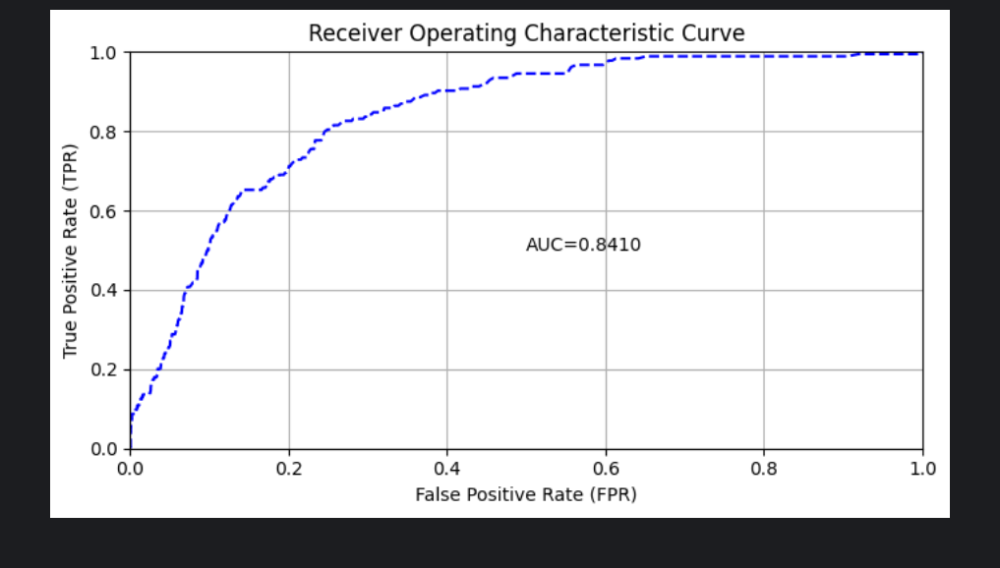
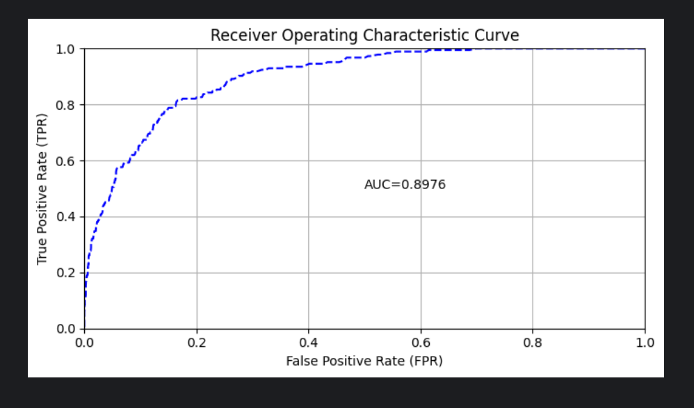
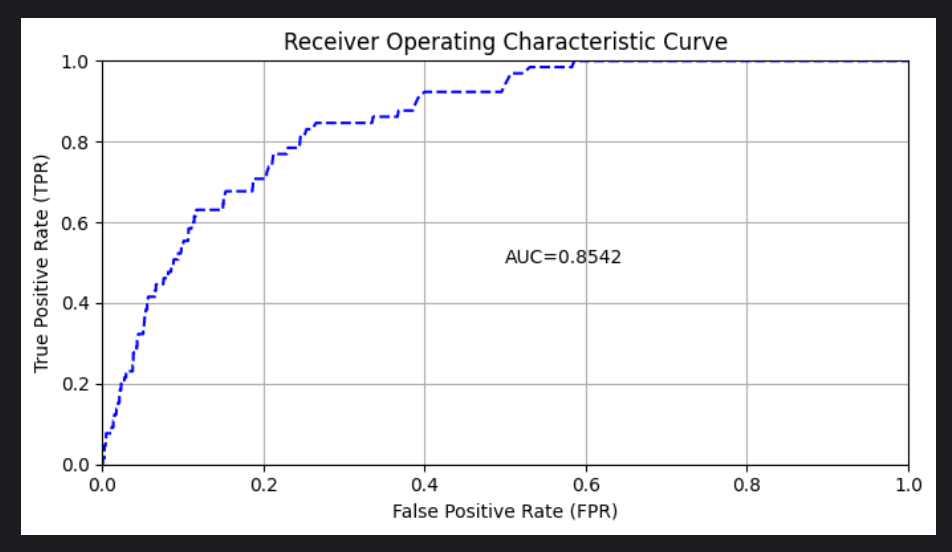
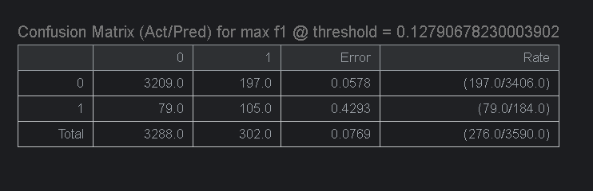
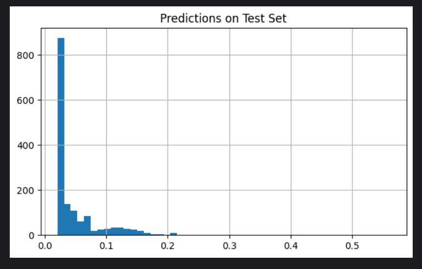

# Stroke Risk Prediction with H2O Gradient Boosting

> Predicting stroke risk from demographic and health data with an **H2O Gradient Boosting Machine**,
> 5-fold cross-validation, threshold tuning for a strongly imbalanced target, and model interpretation.

<p>
  
  
  
  
  
</p>

## Overview
According to the WHO, stroke is the **2nd leading cause of death** worldwide. This project builds a model that
estimates a patient's stroke risk from age, glucose level, BMI, hypertension, heart disease and lifestyle data.

**The challenge:** only **249 of 5,110 patients (4.87%)** had a stroke. A model that always predicts "no stroke"
is already 95% accurate, so accuracy alone is misleading. This project focuses on **AUC, recall, calibration
and a tuned decision threshold** instead.

## Dataset
[Stroke Prediction Dataset (Kaggle)](https://www.kaggle.com/datasets/fedesoriano/stroke-prediction-dataset) —
5,110 rows, 10 predictors, target `stroke`.

| Numerical | Categorical |
|---|---|
| `age`, `avg_glucose_level`, `bmi` | `gender`, `hypertension`, `heart_disease`, `ever_married`, `work_type`, `residence_type`, `smoking_status` |

Full attribute table: [`data/README.md`](data/README.md)

## Pipeline


## Key Findings from EDA
- Risk rises clearly with **age** and **average glucose level**.
- **Hypertension** and **heart disease** strongly increase stroke risk.
- **Missing BMI is a strong signal:** ~20% of patients with missing BMI had a stroke, versus ~3–5% in most BMI
  ranges — so missing values were encoded as `-99` instead of being filled with the mean.
- "Ever married" shows 6.6% stroke rate vs 1.7% — mostly an **age effect** (married patients are older).

## Model
| Parameter | Value |
|---|---|
| Algorithm | `H2OGradientBoostingEstimator` |
| Trees / max depth | 100 / 4 |
| Learning rate | 0.01 |
| Min rows per leaf | 10 |
| Column sample rate | 0.7 |
| Cross-validation | 5-fold |
| Early stopping | 10 rounds |
| Seed | 999 |
| Decision threshold | **0.148** (tuned so predicted positives ≈ actual positives) |

## Results
| Metric | Value |
|---|---:|
| Cross-validation AUC | **0.845 ± 0.016** |
| Accuracy @ 0.148 — train / CV / test | 0.940 / 0.921 / **0.932** |
| Calibration (train) | 184.4 predicted vs 184 actual strokes |

**Test set confusion matrix** (threshold 0.148, 1,520 patients):

| | Pred: no stroke | Pred: stroke |
|---|---:|---:|
| **Actual: no stroke** | 1401 | 54 |
| **Actual: stroke** | 50 | 15 |

More metrics: [`results/metrics.md`](results/metrics.md)

## Figures
| Training scoring history | Cross-validation metrics |
|---|---|
|  |  |

| Training ROC | Test ROC |
|---|---|
|  |  |

| Confusion matrix | Predictions on test set |
|---|---|
|  |  |

## Project Structure
```
├── data/
│   └── README.md                 # dataset source and attributes (CSV not committed)
├── notebooks/
│   └── stroke_risk_prediction_h2o_gbm.ipynb
├── results/
│   ├── figures/                  # 11 plots: scoring history, CV, ROC, confusion matrix, predictions
│   └── metrics.md
├── src/
│   └── train_gbm.py              # same pipeline as a script
├── requirements.txt
└── README.md
```

## How to Run
H2O needs **Java 8–17** installed.

```bash
git clone https://github.com/feroz-afm/stroke-prediction-h2o-gbm.git
cd stroke-prediction-h2o-gbm
pip install -r requirements.txt
```

1. Download `healthcare-dataset-stroke-data.csv` from Kaggle into `data/`
2. Run the script:
   ```bash
   python src/train_gbm.py --data data/healthcare-dataset-stroke-data.csv
   ```
   or open the notebook: `jupyter notebook notebooks/stroke_risk_prediction_h2o_gbm.ipynb`

## Limitations & Future Work
- With threshold 0.148 the model catches **15 of 65** test strokes (recall 23%) — for medical screening a
  **lower threshold** (higher recall, more false alarms) would usually be preferred.
- Try class weights / balancing (`balance_classes=True`), SMOTE, and H2O AutoML.
- Tune the threshold on a cost basis (missed stroke vs. false alarm).
- Add an interactive demo (Streamlit) for single-patient risk.

> ⚠️ This is an educational project, not a medical tool.
