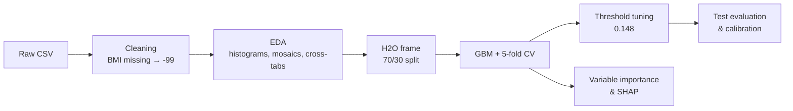

# Stroke Risk Prediction with H2O Gradient Boosting

> Predicting stroke risk from demographic and health data with an **H2O Gradient Boosting Machine**,
> 5-fold cross-validation, threshold tuning for a strongly imbalanced target, and model interpretation.

  
  
  
  
  

## Overview
According to the WHO, stroke is the **2nd leading cause of death** worldwide. This project builds a model that
estimates a patient's stroke risk from age, glucose level, BMI, hypertension, heart disease and lifestyle data.

**The challenge:** only **249 of 5,110 patients (4.87%)** had a stroke. A model that always predicts "no stroke"
is already 95% accurate, so accuracy alone is misleading. This project focuses on **AUC, recall, calibration
and a tuned decision threshold** instead.

## Dataset
[Stroke Prediction Dataset (Kaggle)](https://www.kaggle.com/datasets/fedesoriano/stroke-prediction-dataset) —
5,110 rows, 10 predictors, target `stroke`.

| Numerical | Categorical |
|---|---|
| `age`, `avg_glucose_level`, `bmi` | `gender`, `hypertension`, `heart_disease`, `ever_married`, `work_type`, `residence_type`, `smoking_status` |

Full attribute table: [`data/README.md`](data/README.md)

## Pipeline

